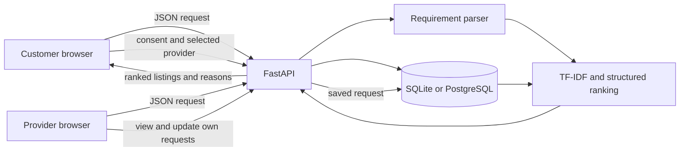
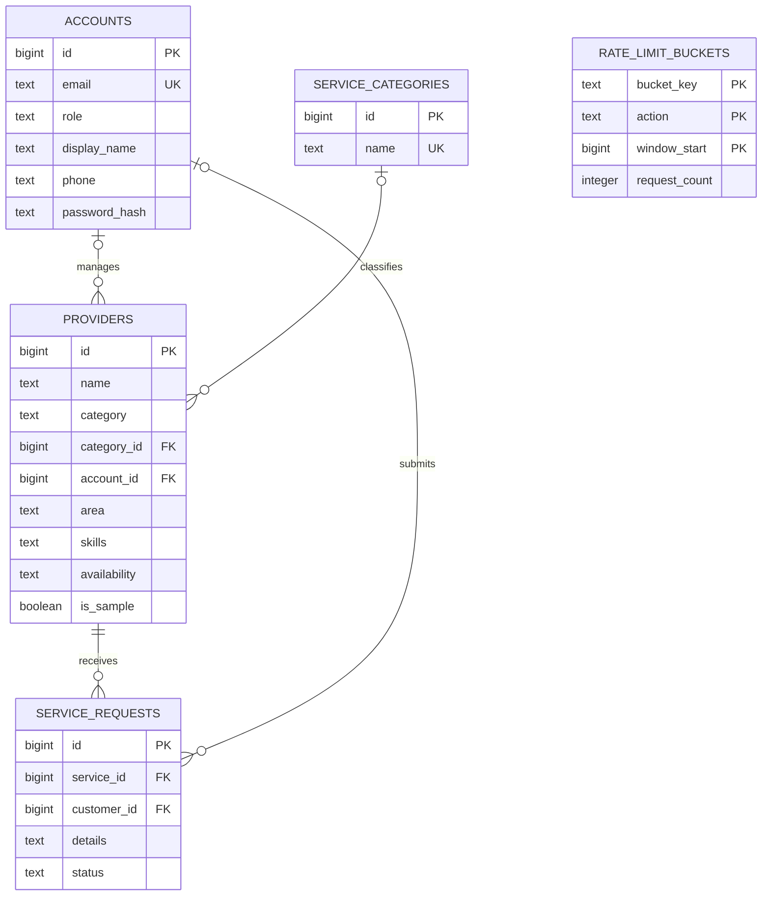

# Barak Valley Connect

I built Barak Valley Connect as a local-services directory for Silchar and nearby areas. The idea is simple: someone who needs help with a household job should be able to find a relevant local provider, understand why that provider appeared in the results, and send a request through the site.

I am a B.Tech Electrical Engineering student at NIT Silchar. I used this project to learn more about building a web application with Python, APIs, databases, and a small NLP-based recommendation system. I also used AI tools during development to understand concepts, debug issues, and improve parts of the project. I reviewed the suggestions and worked on understanding how the final implementation works.

**Live website:** [Barak Valley Connect](https://barak-valley-connect-33ic.onrender.com)  
**GitHub repository:** [biplabxdas/barak-valley-connect](https://github.com/biplabxdas/barak-valley-connect)

## What I built

- A public directory where people can browse providers by service, area, or search text.
- Customer and provider registration and sign-in.
- Provider profiles with category, skills, area, description, and stated availability.
- Customer service requests, consent, and request history.
- A provider inbox for requests on that provider’s own listing, with status updates.
- An owner area for adding, editing, and removing provider listings and managing requests.
- A plain-language search that ranks current provider records and explains its results.
- Clearly labelled synthetic demonstration providers. They are not real businesses; the built-in demo profiles cannot receive requests.

## Technologies I used

- **Backend:** Python, FastAPI, Pydantic, and Uvicorn
- **Database:** SQLite for local development and automated tests; PostgreSQL for the hosted service
- **Frontend:** HTML, CSS, and browser JavaScript served by FastAPI
- **Recommendation:** local TF-IDF and cosine similarity, plus structured matching signals
- **Hosting:** Render web service and Render PostgreSQL

The recommendation feature is a deterministic retrieval and ranking system. It does not call an LLM or a paid AI API.

## How the application works

The browser pages in `static/` send JSON requests to FastAPI routes in `main.py`. FastAPI checks the request data and the signed-in user’s role, then reads or writes data through `connect_db()`. That function uses SQLite when I run the project locally without a `DATABASE_URL`, and PostgreSQL when the hosted database URL is configured.

For a recommendation, the API loads the current provider listings from the database. The query parser looks for a likely service category, skill terms, a known area, and urgency words. The matcher compares the request with each provider’s name, category, description, and skills. The API sends back ranked listings, fit scores, and reasons for the result.



### Main project files

| File | What it does |
|---|---|
| `main.py` | FastAPI routes, validation, sessions, role checks, database setup, and request handling |
| `matcher.py` | Tokenizes text, builds TF-IDF vectors, calculates cosine similarity, ranks listings, and creates reasons |
| `query_understanding.py` | Looks for a likely category, skills, known area, and urgency using local vocabulary |
| `static/index.html`, `static/app.js` | Directory, search, recommendations, accounts, and customer request pages and actions |
| `static/provider.html`, `static/provider.js` | Provider profile page and provider account actions |
| `static/styles.css`, `static/management.css` | Website layout, responsive styles, and account/management styles |
| `test_matcher.py`, `test_api.py` | Recommendation and API tests using isolated SQLite data |
| `render.yaml` | Render web-service and PostgreSQL configuration |
| `.env.example` | Environment variable names and local development defaults |

For a short interview-focused explanation, I keep [INTERVIEW_NOTES.md](INTERVIEW_NOTES.md) separate from this README.

## How my recommendation system works

When someone types a service request:

1. FastAPI checks that the description is within the allowed length.
2. `query_understanding.py` looks for a likely category, useful skill terms, a provider area found in the listings, and urgency words such as “urgent” or “today.”
3. `matcher.py` tokenizes the query and each provider’s profile text. It uses term frequency and inverse document frequency (TF-IDF) to give more weight to words that help distinguish listings.
4. It calculates cosine similarity between the query and provider text. A small synonym list and conservative spelling correction help with some common variations.
5. It combines the text score with skill overlap, category, exact known-area, and provider-stated availability signals.
6. The page shows the interpreted request, ranked listings, scores, and reasons. It also shows a no-match message when no listing is relevant enough.

For a regular request, the weights are text 0.40, skills 0.28, category 0.16, location 0.10, and availability 0.06. For an urgent request, the weights are text 0.33, skills 0.27, category 0.16, location 0.10, and availability 0.14. If the parser cannot identify a category or known area, that signal is left out and the remaining weights are adjusted to total 1. Availability comes from a provider’s profile; it is not a live calendar.

The displayed score is a listing-fit score for that request. It is not a probability, provider rating, endorsement, or guarantee of service quality. This approach works best with common English-language home-service requests and the vocabulary in the project. It can miss less common wording, languages, and more complicated spelling errors. It is not a generative model.

## Customer and provider workflows

**Customer:** Register or sign in, browse or search, describe a job, review the interpretation and results, select a provider, give consent to save the request, and check its status in request history.

**Provider:** Register or sign in, update the listing and stated availability, review requests for that listing, and change request status. A provider cannot update requests belonging to another provider’s listing.

**Website owner:** Sign in to manage listings and requests. Owner credentials are configured in private environment settings, not stored in the repository.

## API overview

FastAPI’s interactive API page is available at `/docs` when the application is running.

| Method and path | Purpose |
|---|---|
| `GET /health` | Check that the app and database can respond |
| `GET /api/providers` | Browse and filter provider listings |
| `GET /api/categories` | List categories with provider listings |
| `GET /api/providers/{provider_id}` | Read a public provider profile |
| `POST /api/recommendations` | Parse a request and rank provider records |
| `POST /api/auth/register` | Create a customer or provider account |
| `POST /api/auth/login`, `POST /api/auth/logout` | Start or end an account session |
| `GET /api/auth/me` | Read the current account session |
| `POST /api/auth/admin-login`, `POST /api/auth/admin-logout` | Start or end the owner session |
| `GET /api/provider/profile`, `PUT /api/provider/profile` | Read or update the signed-in provider’s own listing |
| `POST /api/requests` | Submit a service request with privacy consent |
| `GET /api/my/requests` | View the signed-in customer’s requests |
| `GET /api/provider/requests` | View requests for the signed-in provider’s listing |
| `PATCH /api/provider/requests/{request_id}/status` | Update a request belonging to that provider |
| `POST/PUT/DELETE /api/providers...` | Owner-only provider listing management |
| `GET /api/requests`, `PATCH /api/requests/{request_id}/status`, `DELETE /api/requests/{request_id}` | Owner-only request review, status updates, and deletion |
| `GET /api/summary` | Owner dashboard summary |
| `GET /api/admin/requests.csv` | Owner-only request CSV export |

## Database

The database has five tables:

- `accounts` holds customer and provider account details, roles, and password hashes.
- `service_categories` stores category names used by provider listings.
- `providers` stores the listing, category, area, skills, availability, and whether it is synthetic demo data.
- `service_requests` stores the selected provider, request details, status, and an optional link to a signed-in customer account.
- `rate_limit_buckets` stores shared request-rate counters.

The diagram below follows the current table definitions. A request can exist without a signed-in customer account. The database does not enforce that each provider account can own only one listing.



The diagram shows PostgreSQL types. SQLite uses integer primary keys and an integer for the demo flag. The app uses parameterized queries. When it starts, it creates missing tables and checks for some new columns to add to older databases. These are additive startup checks, not a full versioned migration system. PostgreSQL uses an advisory lock during schema setup.

## Run it locally on macOS

Use Python 3.11 or 3.12. From the project folder, run:

```sh
python3 -m venv .venv
source .venv/bin/activate
python -m pip install -r requirements.txt
cp .env.example .env
```

Open `.env` and set a private local `ADMIN_PASSWORD` if you want to use owner management. A random local `SESSION_SECRET` is generated by the app if this value is left blank; for production it must be set. Leave `DATABASE_URL` empty to use SQLite. Then start the server:

```sh
python -m uvicorn main:app --reload
```

Open [http://127.0.0.1:8000](http://127.0.0.1:8000). A new local SQLite database is seeded with three synthetic sample listings for development.

### Environment variables

These are the variable names used by the app:

| Variable | Purpose |
|---|---|
| `APP_ENV` | Application environment; use `production` for hosted production settings |
| `DATABASE_PATH` | Local SQLite file path; defaults to `business.db` |
| `DATABASE_URL` | PostgreSQL connection URL; leave blank for SQLite |
| `ADMIN_PASSWORD` | Private owner password; production requires at least 16 characters |
| `SESSION_SECRET` | Signs browser sessions; production requires at least 32 characters |
| `SITE_OPERATOR_NAME` | Operator name shown in public site/privacy information |
| `PRIVACY_CONTACT_EMAIL` | Public privacy contact address |
| `REQUEST_RETENTION_DAYS` | Positive number of days to retain service requests |
| `DEMO_PROVIDERS_ENABLED` | Turns synthetic provider seeding on or off |

Do not commit `.env`, database URLs, passwords, session secrets, or customer request details.

## Tests and GitHub Actions

To run the tests locally, install the test dependencies and run the test suite:

```sh
python -m pip install -r requirements-test.txt
python -m unittest discover -v
```

There are 30 test methods: 22 API tests and 8 matcher tests. The API tests use temporary SQLite databases, so they do not replace a separate check against a live PostgreSQL service. GitHub Actions runs the tests and Python/JavaScript syntax checks on Python 3.11 and 3.12 for pull requests and pushes to the configured branches.

## Render deployment

The repository includes `render.yaml` for a Python web service and a same-region PostgreSQL database. The web service runs Uvicorn and uses `/health` as its health check. Private values should be set in Render’s environment settings, not committed to GitHub.

The current live site is [Barak Valley Connect on Render](https://barak-valley-connect-33ic.onrender.com), and the service is connected to `main`. The current PostgreSQL database is on Render’s free plan and is scheduled to expire on **December 12, 2026**. This is suitable for a temporary demonstration, not long-term customer data. Before using the site for real customer records, move to durable PostgreSQL and arrange backups. The app does not make database backups itself.

## Security and privacy

- The app stores PBKDF2-HMAC-SHA256 password hashes, not plaintext passwords.
- Sessions use signed, HTTP-only cookies. In production the cookie requires HTTPS and uses SameSite strict.
- The app stores service-request details only after consent and removes old requests according to `REQUEST_RETENTION_DAYS`.
- Public provider responses do not return phone numbers.
- Email verification, password recovery, automatic email or SMS notifications, and payments are not implemented.

## Screenshots

I have not committed screenshots yet. I have left this section honest rather than adding mockups. Screenshots can be added after they are saved from the running application.

## Limitations

- Recommendation results depend on the provider information and the local vocabulary in the project.
- The parser may miss less common wording, other languages, and complex spelling mistakes.
- Availability is what a provider has stated in their profile, not a live appointment calendar.
- Database updates on startup are additive checks, not managed versioned migrations.
- The current free Render PostgreSQL database expires on December 12, 2026 and is not a long-term production storage plan.
- Account email verification, password reset, payments, and automatic contact notifications are not implemented.
