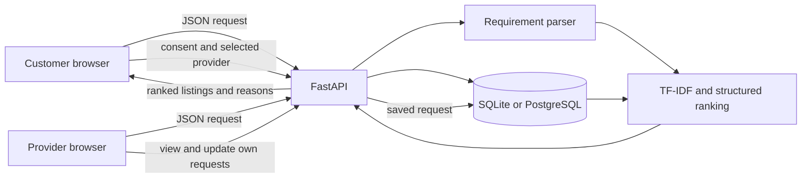

# Barak Valley Connect

Barak Valley Connect is a local-services directory for Silchar and nearby areas. The project lets people browse provider listings, describe a job in everyday language, and review providers that appear relevant. Customers can submit requests and follow their status; providers manage their own listing and incoming requests.

**Live site:** [barak-valley-connect-33ic.onrender.com](https://barak-valley-connect-33ic.onrender.com)  
**Source:** [github.com/biplabxdas/barak-valley-connect](https://github.com/biplabxdas/barak-valley-connect)

## What it does

- Browse providers by service, area, or search text.
- Register and sign in as a customer or provider.
- Let providers manage their listing, skills, service area, and stated availability.
- Submit consent-based service requests and view customer request history.
- Let providers review requests for their listing and update request status.
- Give the website owner tools to add, edit, and remove provider listings and manage requests.
- Analyze a plain-language service request and rank current provider records with explanations.
- Clearly identify synthetic demonstration providers. They are not real businesses, and the built-in demo listings cannot receive requests.

## Technology

- Python, FastAPI, Pydantic, and Uvicorn
- SQLite for local development and automated tests
- PostgreSQL for the hosted service
- HTML, CSS, and browser JavaScript, served by FastAPI
- A local TF-IDF and cosine-similarity matcher with structured ranking signals
- Render for the web service and PostgreSQL resource

The recommendation feature does not call an LLM or a paid AI API. It is a deterministic retrieval and ranking system.

## How the application fits together

The browser pages in `static/` call same-origin JSON endpoints in `main.py`. FastAPI validates request data, checks the signed-in account and role, then uses `connect_db()` to read or write SQLite or PostgreSQL. The recommendation endpoint loads provider details from that same database before ranking them.



### Main files

| File | Purpose |
|---|---|
| `main.py` | FastAPI routes, validation, sessions, authorization, database setup, and request handling |
| `matcher.py` | Text tokenization, TF-IDF vectors, cosine similarity, signal weighting, ranking, and reasons |
| `query_understanding.py` | Local extraction of likely category, skills, known area, and urgency |
| `static/index.html`, `static/app.js` | Directory, search, recommendations, accounts, and customer request flows |
| `static/provider.html`, `static/provider.js` | Provider profile page and provider account workflows |
| `static/styles.css`, `static/management.css` | Responsive layout and account/management styles |
| `test_matcher.py`, `test_api.py` | Recommendation and API tests using isolated SQLite data |
| `render.yaml` | Render web-service and PostgreSQL configuration |
| `.env.example` | Names and local-development defaults for environment variables |

## Recommendation method

When a customer submits a short service description:

1. The API validates its length and asks `query_understanding.py` to find a likely service category, useful skill terms, a known provider area, and urgency words.
2. The matcher builds a query and one text document per current provider from the name, category, description, skills, and category vocabulary.
3. It calculates TF-IDF term weights and cosine similarity. A small curated synonym list and conservative close-spelling correction help with common variations.
4. It combines text similarity with skill overlap, category, exact known-area, and provider-stated availability signals.
5. The API returns the parsed request, ranked listing-fit scores, signal values, and plain-language reasons. The UI also handles empty and no-match results.

The regular-request weights are text 0.40, skills 0.28, category 0.16, location 0.10, and availability 0.06. For urgent requests, text is 0.33, skills 0.27, category 0.16, location 0.10, and availability 0.14. If the parser cannot identify a category or known area, that signal is omitted and the remaining weights are normalized. Availability is self-reported, not a live calendar.

The displayed score describes how well a listing matches this request. It is not a probability, provider rating, quality guarantee, or endorsement. The parser uses a small local vocabulary and is strongest for common English-language home-service descriptions; it will miss some uncommon wording, languages, or complex misspellings. It is not a generative model.

## Customer and provider flows

**Customer:** register or sign in, search the directory or describe a job, review the interpreted fields and ranked results, select a provider, consent to saving the request, then follow its status in request history.

**Provider:** register or sign in, update the provider listing and stated availability, review requests addressed to that listing, and update request status. Providers cannot change requests attached to another provider's listing.

**Website owner:** use the owner sign-in and management area to maintain listings and review or manage requests. Owner credentials are kept in private environment settings, not in the repository.

## API overview

FastAPI's interactive API schema is available at `/docs` on a running instance.

| Method and path | Purpose |
|---|---|
| `GET /health` | Check application and database connectivity |
| `GET /api/providers` | Browse and filter current listings |
| `GET /api/categories` | List provider categories |
| `GET /api/providers/{provider_id}` | Read a public provider profile |
| `POST /api/recommendations` | Parse a request and rank database provider records |
| `POST /api/auth/register` | Create a customer or provider account |
| `POST /api/auth/login`, `POST /api/auth/logout` | Start or end an account session |
| `GET /api/auth/me` | Read the current account session |
| `POST /api/auth/admin-login`, `POST /api/auth/admin-logout` | Start or end the owner session |
| `GET /api/provider/profile`, `PUT /api/provider/profile` | Read or update the signed-in provider's own listing |
| `POST /api/requests` | Submit a request with privacy consent |
| `GET /api/my/requests` | View the signed-in customer's requests |
| `GET /api/provider/requests` | View requests for the signed-in provider's listing |
| `PATCH /api/provider/requests/{request_id}/status` | Update a request belonging to that provider |
| `POST/PUT/DELETE /api/providers...` | Owner-only provider listing management |
| `GET/PATCH/DELETE /api/requests...` | Owner-only request management |

## Database

The database has four main data areas:

- `accounts`: customer/provider account, role, display name, phone, and password hash.
- `service_categories`: category names referenced by provider listings.
- `providers`: listing, service category, area, skills, availability, and synthetic-demo flag.
- `service_requests`: selected provider, customer details, request description, status, and optional signed-in customer account.

A database-backed table also stores shared rate-limit counters. PostgreSQL connections are opened per operation and use parameterized queries. On startup, the app creates missing tables and applies additive column checks for older databases; this is not a versioned migration system. PostgreSQL startup uses an advisory lock around schema initialization.

## Run locally on macOS

Use Python 3.11 or 3.12. From the project directory:

```sh
python3 -m venv .venv
source .venv/bin/activate
python -m pip install -r requirements.txt
cp .env.example .env
```

Edit `.env` and set a private local `ADMIN_PASSWORD`. A local `SESSION_SECRET` can be generated by the application when left blank, though you can set a random value of at least 32 characters. Keep `DATABASE_URL` empty to use SQLite. Then run:

```sh
python -m uvicorn main:app --reload
```

Open [http://127.0.0.1:8000](http://127.0.0.1:8000). For local development, an empty SQLite database is seeded with three synthetic sample listings. Those records are only for local testing.

### Environment variables

The application reads these values:

| Variable | Purpose |
|---|---|
| `APP_ENV` | Set to `production` for hosted production configuration |
| `DATABASE_PATH` | Local SQLite file path; defaults to `business.db` |
| `DATABASE_URL` | PostgreSQL connection URL; leave blank for SQLite |
| `ADMIN_PASSWORD` | Private website-owner password; production requires at least 16 characters |
| `SESSION_SECRET` | Signs browser sessions; production requires at least 32 characters |
| `SITE_OPERATOR_NAME` | Name shown in public site/privacy information |
| `PRIVACY_CONTACT_EMAIL` | Public privacy contact address |
| `REQUEST_RETENTION_DAYS` | Positive number of days to retain service requests |
| `DEMO_PROVIDERS_ENABLED` | Explicitly enable or disable synthetic provider seeding |

Do not commit `.env`, a database URL, passwords, session secrets, or customer information.

## Tests and CI

Install the test dependencies and run the suite:

```sh
python -m pip install -r requirements-test.txt
python -m unittest discover -v
```

The suite contains 30 tests across the API and matcher modules. API tests use temporary SQLite data; they do not replace a live PostgreSQL check. GitHub Actions runs the suite and Python/JavaScript syntax checks on Python 3.11 and 3.12 for pull requests and pushes to the configured branches.

## Deployment

The repository includes `render.yaml`. It defines the Python web service, a same-region PostgreSQL resource, the `/health` check, and private environment values. In Render, review the Blueprint plan before applying it and set private values through the dashboard. Do not copy credentials into GitHub or chat.

The current public deployment is [Barak Valley Connect on Render](https://barak-valley-connect-33ic.onrender.com). The service runs from `main`. The current PostgreSQL instance is on Render's free plan and is scheduled to expire on **December 12, 2026**. It is suitable for a temporary demonstration, not dependable long-term storage. Before using the site for real customer data, move to a durable PostgreSQL plan and arrange backups. The application does not create its own backup copies.

## Privacy and security notes

- Passwords are stored as PBKDF2-HMAC-SHA256 hashes, not plaintext.
- Sessions use signed, HTTP-only cookies; production cookies require HTTPS and use SameSite strict.
- Customer request details are stored after consent and removed according to `REQUEST_RETENTION_DAYS`.
- Public provider responses do not return provider phone numbers.
- Email verification, password recovery, automated email/SMS notifications, and payments are not implemented.

## Screenshots

There are no committed screenshots in the repository at the moment. I have not added mockups in their place. The live site can be opened from the link above; screenshots should be added here after capturing them directly from the running application.

## Known limitations

- Matching quality depends on the curated vocabulary, listed provider information, and available provider coverage.
- Availability is the provider's stated status, not an appointment calendar.
- Startup schema updates are additive checks rather than managed, versioned migrations.
- The current hosted PostgreSQL plan expires on December 12, 2026 and does not provide a long-term production guarantee.
- The app has no email confirmation, account password reset, payment flow, or automatic contact notifications.
