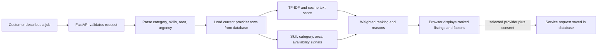

# Barak Valley Connect

Barak Valley Connect is a local services directory for Silchar and nearby areas. Customers can describe a job in plain language and see explainable provider recommendations based on listing text, required skills, service category, requested area, and provider-stated availability.

The recommendation engine is a deterministic information-retrieval system. It uses TF-IDF, cosine similarity, curated service vocabulary, and structured signals. It is not a generative AI chatbot, trained language model, endorsement, or probability estimate.

## Features

- Browse and filter providers by service category, area, and text.
- Create customer and provider accounts with role-scoped access.
- Let providers edit their own public listing and stated availability.
- Analyze service descriptions for likely category, skills, area, and urgency.
- Rank current database listings and explain the signals behind each result.
- Mark synthetic demonstration profiles clearly; production demo profiles cannot receive real service requests.
- Submit consent-based service requests to real provider listings and view account history.
- Use the website owner area to manage listings and requests.
- Run locally with SQLite or in production with PostgreSQL.

## Technology stack

- **Backend:** Python 3.11+, FastAPI, Pydantic, Uvicorn
- **Database:** SQLite for local development and tests; PostgreSQL through psycopg for the hosted service
- **Frontend:** semantic HTML, responsive CSS, and browser-native JavaScript; no frontend build step
- **Matching:** Python standard-library TF-IDF and cosine similarity with a curated local service vocabulary
- **Hosting:** Render web service and Render PostgreSQL Blueprint

The matcher does not call an LLM or a paid AI API. Query understanding uses transparent vocabulary rules and conservative spelling correction.

## Project layout

```text
main.py                     FastAPI routes, validation, auth, database and migrations
matcher.py                  TF-IDF text similarity and feature-based ranking
query_understanding.py       Local vocabulary parser for category, skills, area and urgency
static/index.html            Main directory and recommendation interface
static/app.js                Frontend API calls, search, accounts and request flows
static/provider.html         Provider profile page
static/provider.js           Provider profile API integration
static/styles.css            Main and responsive styles
static/management.css        Account, owner and profile styles
test_matcher.py              Offline NLP and ranking tests
test_api.py                  FastAPI workflows using an isolated SQLite database
render.yaml                  Render web service and PostgreSQL Blueprint
requirements.txt             Runtime dependencies
requirements-test.txt        Runtime plus automated test dependencies
```

## Run on macOS

Use Python 3.11 or later. From this folder:

```sh
python3 -m venv .venv
source .venv/bin/activate
python -m pip install -r requirements.txt
cp .env.example .env
```

Set a private local `ADMIN_PASSWORD` and a random `SESSION_SECRET` in `.env`. Keep `DATABASE_URL` blank to use SQLite. Start the app:

```sh
python -m uvicorn main:app --reload
```

Open [http://127.0.0.1:8000](http://127.0.0.1:8000). The local directory is seeded with three clearly marked synthetic listings. A local listing exists only to make development and recommendation demonstrations possible.

To run the automated tests:

```sh
python -m pip install -r requirements-test.txt
python -m unittest -v
```

## Architecture and data

`static/app.js` sends same-origin JSON requests to the FastAPI routes in `main.py`. Pydantic models validate request bodies. FastAPI uses signed, HTTP-only session cookies and role checks for customer, provider, and owner actions. Database access goes through `connect_db()`, which uses SQLite locally and PostgreSQL when `DATABASE_URL` is set.

The database stores accounts, service categories, providers, service requests, and shared rate-limit counters. Providers include category, service area, description, skills, sample-data flag, and provider-stated availability (`Available`, `Busy`, `Unavailable`, or `Not specified`). Existing databases receive the availability field through an additive startup migration. A legacy listing defaults to `Not specified` rather than being assumed available. PostgreSQL startup uses an advisory lock to avoid concurrent schema changes.

The public recommendation request is not stored. Provider descriptions and skills used for matching come from the configured database. Service-request details are stored only after explicit consent and are removed according to `REQUEST_RETENTION_DAYS`.

## Recommendation flow

1. The browser sends a short description to `POST /api/recommendations`.
2. `query_understanding.py` uses a local service vocabulary, stop words, curated synonym expansions, provider areas, and simple urgency terms to identify likely category, useful skill terms, a known area, and whether the request sounds urgent. It can correct close spellings using the provider directory vocabulary.
3. `main.py` loads actual public listing fields from PostgreSQL or SQLite and passes them to `matcher.rank_providers()`.
4. `matcher.py` compares TF-IDF text similarity and skill overlap, then adds category, exact known-area, and stated-availability signals when the request provides those details. Urgency increases the importance of availability. Weights are normalized if no category or known area was found.
5. The API returns the parsed request, a weighted listing-fit score, component signals, and plain-language reasons. The UI shows the interpreted request and match factors.

Default signal weights are text 0.40, skills 0.28, category 0.16, area 0.10, and availability 0.06. For urgent requests they are text 0.33, skills 0.27, category 0.16, area 0.10, and availability 0.14. Missing category or area signals are omitted and the remaining weights are normalized. An unavailable profile can still appear when its service is relevant, but its availability signal lowers its rank and is shown to the user.

TF-IDF uses a smoothed inverse document frequency:

```text
idf(t) = ln((N + 1) / (df(t) + 1)) + 1
```

Cosine similarity measures the angle between query and listing term vectors. The displayed composite score is a fit estimate for the current listings, not a probability, provider quality rating, or endorsement. Results below a relevance threshold are omitted; no-match and empty-directory states are handled explicitly.

The parser is intentionally local and inspectable. It does not understand all sentence meanings, arbitrary synonyms, or every language, and availability is self-reported rather than live scheduling data. Recommendation quality should be evaluated against consented, human-labeled queries before use in consequential decisions.



## Example demonstration flow

1. Search for **“Urgent electrician to fix a noisy ceiling fan and exposed wiring near Silchar.”**
2. Review the parsed category, skills, area, and urgency. Open **See match factors** to view the text, skill, category, location, and availability signals.
3. Follow a provider profile to see its skills and availability. The seeded synthetic listings are labelled as demonstrations and cannot receive requests.
4. Register a customer or provider account. Providers can update their listing and availability; customers can see their own request history.
5. For a live request demonstration, use a clearly identified QA provider account and synthetic customer data. Do not send requests to a real provider without their consent.

The example is a user-facing explanation of the implemented flow. It does not imply that the matcher understands every word semantically or that the score predicts service quality.

## API overview

Interactive schema: `/docs`.

| Method | Path | Purpose |
|---|---|---|
| GET | `/health` | Checks application and database connectivity |
| GET | `/api/providers` | Browse and filter current provider listings |
| GET | `/api/categories` | List categories that have providers |
| GET | `/api/providers/{id}` | Read a public profile; phone remains private |
| POST | `/api/recommendations` | Analyze a requirement and rank actual provider rows |
| POST | `/api/auth/register` | Register a customer or provider account |
| POST | `/api/auth/login`, `/api/auth/logout` | Start or end an account session |
| GET | `/api/auth/me` | Read the current account session |
| POST | `/api/auth/admin-login`, `/api/auth/admin-logout` | Start or end the website owner session |
| GET/PUT | `/api/provider/profile` | Read or update the signed-in provider's own profile |
| POST | `/api/requests` | Submit a request with explicit privacy consent |
| GET | `/api/my/requests` | View the signed-in customer's own requests |
| GET | `/api/provider/requests` | View requests for the signed-in provider's listing |
| GET/PATCH/DELETE | `/api/requests...` | Owner-only request management |
| POST/PUT/DELETE | `/api/providers...` | Owner-only listing management |

Owner management routes require the owner session. Public provider responses never include phone numbers.

## Synthetic demonstration providers

When the production provider directory is empty, the app inserts six synthetic listings across common local-service categories. Each is marked in the UI and database as a synthetic demo profile; their phone values are non-contact placeholders. Seeding is idempotent and runs only when there are no listings. Set `DEMO_PROVIDERS_ENABLED=false` to disable production demo seeding. Synthetic listings cannot receive service requests in production. Do not present them as real businesses or users.

## Render deployment

`render.yaml` describes the current Python web service and same-region PostgreSQL resource. The web process binds to `0.0.0.0:$PORT`; `/health` runs a database `SELECT 1`. Render gets `DATABASE_URL` from the private database connection. Set the private owner password and privacy contact through Render's environment settings; never put them in Git.

Required production values are `APP_ENV=production`, `DATABASE_URL`, `SESSION_SECRET` (at least 32 characters), `ADMIN_PASSWORD` (at least 16 characters), `SITE_OPERATOR_NAME`, `PRIVACY_CONTACT_EMAIL`, and positive `REQUEST_RETENTION_DAYS`. `DEMO_PROVIDERS_ENABLED` defaults to true only in production and can be explicitly disabled.

The currently configured demo site is [barak-valley-connect-33ic.onrender.com](https://barak-valley-connect-33ic.onrender.com). Its free PostgreSQL resource is temporary (currently scheduled to expire December 12, 2026); use durable, backed-up PostgreSQL before relying on it for real customer records. The older service was left untouched. Changes are on `codex/final-barak-valley-connect`; they are not merged into `main`.

The release-readiness run exercised customer and provider registration/login, provider self-edit, matching and explanations, request submission, customer history after a new login, and the provider's request inbox using synthetic QA details. The browser showed the same saved request in both role-scoped views after logout and sign-in. The public production `/health` endpoint returned an OK response. The automated test suite runs on an isolated SQLite database; this is separate from the live PostgreSQL workflow check.

The Phase 3 synthetic QA provider listing and its consented test request were removed through owner management on November 14, 2026. Two synthetic QA accounts remain; no account deletion or real-customer data deletion was performed.

Responsive verification details and known physical-device limits are recorded in the responsive check section below. Browser screenshots were captured during release review, but image files are not committed in this repository.


## Responsive and release check (November 14, 2026)

The provider directory was checked at 390 px (mobile) and 1440 px (desktop) in the local browser, and at 768 px (tablet) on the deployed website. The 768 px check exposed a horizontal-overflow issue in the three-column cards; the feature branch now uses two columns below 900 px and wraps long demonstration labels. After deployment, the 768 px page width and document width both measured 768 px. A physical phone and tablet were not used.

The labelled QA provider listing and request were removed through the owner dashboard on November 14, 2026. Six synthetic demonstration providers remain. Two QA accounts remain; the application does not provide customer-account self-deletion. No real customer records were deleted.

Repository screenshot image files are not included in this branch. The live homepage and public demo profiles can be opened at [the deployed site](https://barak-valley-connect-33ic.onrender.com/). The browser screenshot used during this release check is available in the handover conversation, but has not been committed as a README image.
